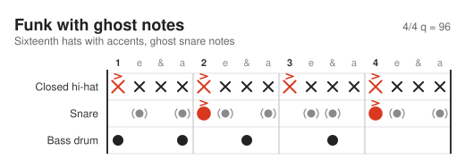
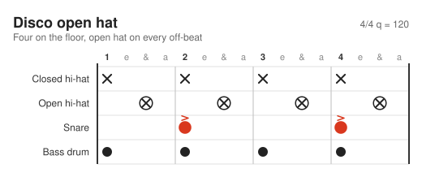
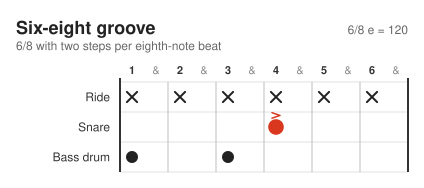
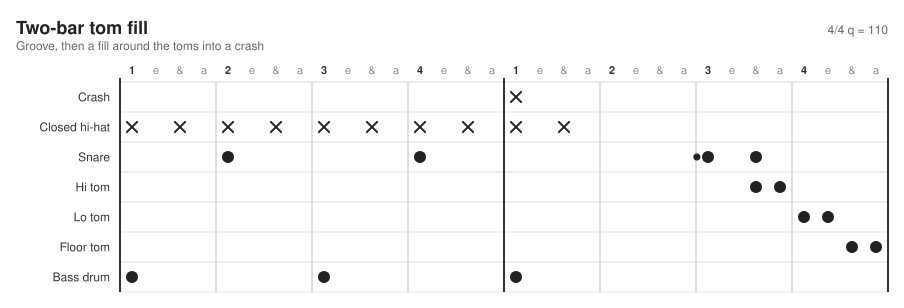
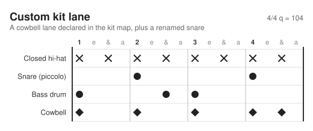

# drumdrom

Drum patterns as text. Write a groove in JSON5, get an SVG lane chart. Inspired by [WaveDrom](https://wavedrom.com) and the sibling project [fretdrom](https://github.com/morganp/fretdrom).


```json5 drumdrom
{
  format: 'drumdrom',
  version: 1,
  name: 'Rock backbeat',
  subtitle: 'Eighth-note hats, kick on 1 and 3, snare on 2 and 4',
  tempo: 100,
  time: [4, 4],
  steps_per_beat: 4,
  lanes: [
    { id: 'hh', wave: 'x.x.x.x.x.x.x.x.' },
    { id: 'sd', wave: '....x.......x...' },
    { id: 'bd', wave: 'x.......x.......' }
  ]
}
```

One character per step, one lane per drum. `x` is a hit, `X` an accent, `o` a ghost note, `.` a rest. The format is described in [docs/spec.md](docs/spec.md) and checked by a [JSON Schema](schema/drumdrom.schema.json) plus semantic validation with located error messages.

## Install

```sh
npm install drumdrom
```

Node 18 or newer. Until it is published, clone the repository and run `npm install`.

## Quick start

Save the example above as `backbeat.drumdrom` (or `.json5`), then:

```sh
npx drumdrom render -i backbeat.drumdrom -o backbeat.svg
```

From code:

```js
const { renderSVG, parse, validate } = require('drumdrom');

const svg = renderSVG(source, { skin: 'dark' }); // source: JSON5 text, object or model
const model = parse(source);                     // normalised model, throws DrumDromError
const { ok, errors } = validate(source);         // all problems, never throws
```

## CLI

```
drumdrom render [-i <file|->] [-o <out.svg>] [-s <skin>]
drumdrom -i <file>                 shorthand for render
drumdrom validate <file|->...      print every error with path, line and column
drumdrom json [-i <file|->]        print the normalised model
drumdrom --help | --version
```

Input comes from stdin when `-i -` is given, or when no input is given and stdin is piped. Exit codes: 0 success, 1 invalid input or unreadable file, 2 usage error.

```
$ drumdrom validate groove.drumdrom
groove.drumdrom: lanes[1].wave (line 7, column 31): lane 'sd': unknown character 'z' at index 3 in wave (allowed: . - x X o O f and '|') [E_BAD_CHAR]
```

## Browser

Build the bundle (`npm run build`, output in `dist/`) and include it. Every `<script type="drumdrom">` is replaced by an inline SVG when `DrumDrom.processAll()` runs:

```html
<script src="dist/drumdrom.min.js"></script>
<script type="drumdrom">
{
  format: 'drumdrom', version: 1,
  lanes: [
    { id: 'sd', wave: '....x.......x...' },
    { id: 'bd', wave: 'x.......x.......' }
  ]
}
</script>
<script>DrumDrom.processAll();</script>
```

A pattern with errors shows its error list in place of the diagram. See `examples/index.html`.

## Format summary

| Key | Meaning |
| --- | --- |
| `format`, `version` | `"drumdrom"` and `1`, both required |
| `name`, `subtitle` | titles |
| `tempo` | beats per minute, 20 to 400 |
| `time` | `[beats, unit]`, default `[4, 4]` |
| `steps_per_beat` | 1 to 12, default 4 (a beat is one unit of the time signature denominator) |
| `kit` | custom lanes and overrides |
| `lanes` | `{ id, wave, name?, pitch? }` |
| `config` | skin, `bars_per_row` and skin overrides |
| `sections` | reserved, rejected in version 1 |

Wave alphabet: `.` `-` rest, `x` hit, `X` accent, `o` ghost, `O` open hi-hat (on `hh`), `f` flam, `|` bar separator. Reserved for later: `r` `b` `d` `^` `1`-`9`.

Default kit, top to bottom on a chart: `cr` crash, `rd` ride, `hh` closed hat, `ho` open hat, `hp` pedal hat, `sd` snare, `rs` rimshot, `cs` cross stick, `t1` hi tom, `t2` lo tom, `t3` floor tom, `bd` bass drum.

## Examples

Funk with ghost notes:



Open hi-hat disco groove (`O` on `hh` becomes a hit on the open hat lane):



Six-eight with `time: [6, 8]` and `steps_per_beat: 2`:



Two-bar fill with toms and a flam:



A custom kit lane:



The images are rendered from `test/fixtures/*.json5` by `npm run docs`.

## Development

```sh
npm install
npm test
npm run lint
npm run build            # dist/drumdrom.js and dist/drumdrom.min.js
npm run docs             # regenerate docs/images
npm run update-snapshots # regenerate test/snapshots after an intended render change
```

See [CONTRIBUTING.md](CONTRIBUTING.md) and [docs/skins.md](docs/skins.md).

## Roadmap

Next: a web editor.

Later:

- percussion staff renderer (the model already carries GM notes and staff positions)
- MIDI export (General MIDI channel 10)
- ASCII drum tab import and export
- MusicXML export (unpitched)
- LilyPond `drummode` export
- Hydrogen export
- sections, repeats and tempo changes
- triplet and swing grids
- roll, buzz and drag (reserved wave characters)
- a Swift package to parse and serialise drumdrom for the Metronome app

## License

MIT, see [LICENSE](LICENSE).
