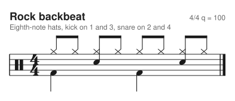
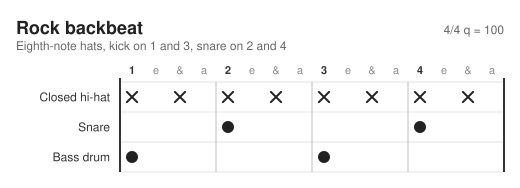
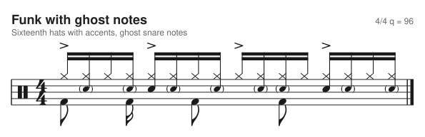
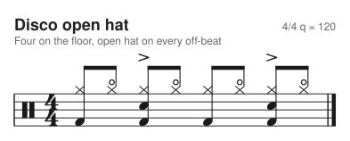
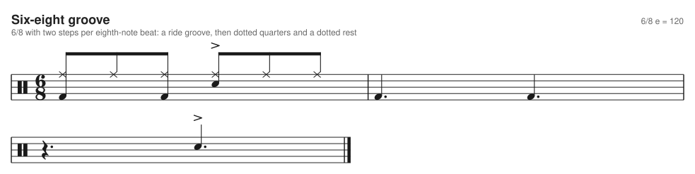
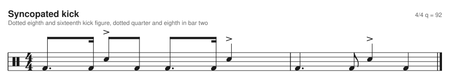
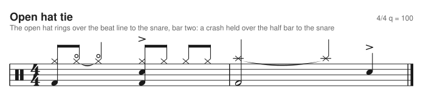
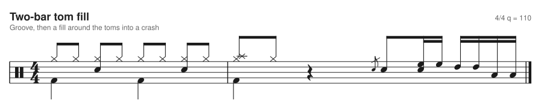
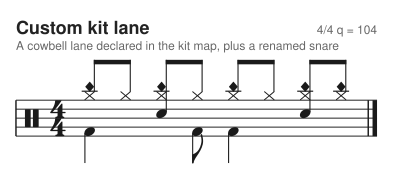
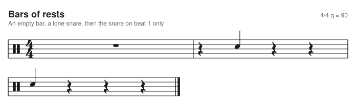

# drumdrom

Drum patterns as text. Write a groove in JSON5, get engraved percussion notation as SVG, or a WaveDrom style lane chart. Inspired by [WaveDrom](https://wavedrom.com) and the sibling project [fretdrom](https://github.com/morganp/fretdrom).



```json5 drumdrom
{
  format: 'drumdrom',
  version: 1,
  name: 'Rock backbeat',
  subtitle: 'Eighth-note hats, kick on 1 and 3, snare on 2 and 4',
  tempo: 100,
  time: [4, 4],
  steps_per_beat: 4,
  lanes: [
    { id: 'hh', wave: 'x.x.x.x.x.x.x.x.' },
    { id: 'sd', wave: '....x.......x...' },
    { id: 'bd', wave: 'x.......x.......' }
  ]
}
```

The same pattern as a lane chart (`--style lanes`, the default for now):



One character per step, one lane per drum. `x` is a hit, `X` an accent, `o` a ghost note, `.` a rest. The format is described in [docs/spec.md](docs/spec.md) and checked by a [JSON Schema](schema/drumdrom.schema.json) plus semantic validation with located error messages.

## Install

```sh
npm install drumdrom
```

Node 18 or newer. Until it is published, clone the repository and run `npm install`.

## Quick start

Save the example above as `backbeat.drumdrom` (or `.json5`), then:

```sh
npx drumdrom render -i backbeat.drumdrom --style staff -o backbeat.svg
```

From code:

```js
const { renderStaff, renderLanes, renderSVG, parse, validate } = require('drumdrom');

const staff = renderStaff(source, { skin: 'dark' });   // percussion staff, source: JSON5 text, object or model
const lanes = renderLanes(source);                     // lane chart
const both = renderSVG(source, { style: 'both' });     // style: 'lanes' (default), 'staff' or 'both'
const model = parse(source);                           // normalised model, throws DrumDromError
const { ok, errors } = validate(source);               // all problems, never throws
```

`renderTree` returns the same drawing as an onml tree. Staff output needs `steps_per_beat` of 1, 2, 4 or 8; a triplet grid throws `E_STAFF_GRID`.

## CLI

```
drumdrom render [-i <file|->] [-o <out.svg>] [-s <skin>] [--style staff|lanes|both]
drumdrom -i <file>                 shorthand for render
drumdrom validate <file|->...      print every error with path, line and column
drumdrom json [-i <file|->]        print the normalised model
drumdrom --help | --version
```

`--style` picks the drawing: `lanes` (the default, as in 0.1.0), `staff` for percussion notation, or `both` to stack the staff above the lanes. Input comes from stdin when `-i -` is given, or when no input is given and stdin is piped. Exit codes: 0 success, 1 invalid input or unreadable file, 2 usage error.

```
$ drumdrom validate groove.drumdrom
groove.drumdrom: lanes[1].wave (line 7, column 31): lane 'sd': unknown character 'z' at index 3 in wave (allowed: . - x X o O f and '|') [E_BAD_CHAR]
```

## HTML pages

Load the hosted bundle from jsDelivr, no build and no install. Every `<script type="drumdrom">` is replaced by an inline SVG when `DrumDrom.processAll()` runs:

```html
<script src="https://cdn.jsdelivr.net/gh/morganp/drumdrom@dist/drumdrom.min.js"></script>
<script type="drumdrom">
{
  format: 'drumdrom', version: 1,
  lanes: [
    { id: 'sd', wave: '....x.......x...' },
    { id: 'bd', wave: 'x.......x.......' }
  ]
}
</script>
<script>DrumDrom.processAll();</script>
```

Or render a pattern yourself. `renderSVG` takes JSON5 text, an object or a model and returns an SVG string; `validate` returns every error with path, line and column:

```html
<div id="groove"></div>
<script>
  const source = "{ format: 'drumdrom', version: 1, lanes: [{ id: 'bd', wave: 'x...x...x...x...' }] }";
  document.getElementById('groove').innerHTML = DrumDrom.renderSVG(source, { style: 'staff' });
</script>
```

A pattern with errors shows its error list in place of the diagram when `processAll` renders it. The default drawing is the lane chart. Choose another with `data-style` on a script, or for all of them with `DrumDrom.processAll({ style: 'staff' })`:

```html
<script type="drumdrom" data-style="staff"> ... </script>
```

`@dist` is a moving ref that tracks the latest build of `main` (CI asks jsDelivr to refresh it after each deploy, but a CDN edge can lag for a while). For a page you do not want to change under you, pin a release with the immutable ref `@dist-v0.4.1`:

```html
<script src="https://cdn.jsdelivr.net/gh/morganp/drumdrom@dist-v0.4.1/drumdrom.min.js"></script>
```

The bundle does not compile anything at run time (no `eval`, no `new Function`; the schema validator is generated at build time), so it works under a strict Content-Security-Policy without `'unsafe-eval'`. It is 127 KB minified and 42 KB gzipped, down from 250 KB and 82 KB in 0.4.0, which bundled ajv. Validation is the same in the bundle and in Node.

For development, `npm run build` writes the bundles to `dist/` and `examples/index.html` can load `../dist/drumdrom.js`. See `examples/index.html`.

## Format summary

| Key | Meaning |
| --- | --- |
| `format`, `version` | `"drumdrom"` and `1`, both required |
| `name`, `subtitle` | titles |
| `tempo` | beats per minute, 20 to 400 |
| `time` | `[beats, unit]`, default `[4, 4]` |
| `steps_per_beat` | 1 to 12, default 4 (a beat is one unit of the time signature denominator) |
| `kit` | custom lanes and overrides |
| `lanes` | `{ id, wave, name?, staff? }` |
| `config` | skin, `bars_per_row`, `voices` (staff: 1 or 2) and skin overrides |
| `sections` | reserved, rejected in version 1 |

Wave alphabet: `.` `-` rest, `x` hit, `X` accent, `o` ghost, `O` open hi-hat (on `hh`), `f` flam, `|` bar separator. Reserved for later: `r` `b` `d` `^` `1`-`9`.

Default kit, top to bottom on a chart: `cr` crash, `rd` ride, `hh` closed hat, `ho` open hat, `hp` pedal hat, `sd` snare, `rs` rimshot, `cs` cross stick, `t1` hi tom, `t2` lo tom, `t3` floor tom, `bd` bass drum.

## Examples

The staff is one voice by default: every stem points up and all notes that sound together share one stem, as in the Metronome app. Set `config: { voices: 2 }` for hands stems up and feet (bass drum, pedal hat) stems down as two voices.

In one voice a bar is spelled whole: a hit that runs exactly to the next one is a dotted note (a dotted eighth and a sixteenth, a dotted quarter in 4/4 from beat 1 or 3, a dotted quarter beat in 6/8), silences get dotted rests where standard, and an open hat, crash or ride that rings past what one note can show is tied. Nothing crosses the half bar line of 4/4. Two voices keep the per beat spelling. The rules are in `docs/spec.md` section 13.

Funk with ghost notes (parentheses on the snare, lighter hats), accents and kick and hat sharing stems (one voice, all stems up):



Open hi-hat disco groove (`O` on `hh` becomes a hit on the open hat lane):



Six-eight with `time: [6, 8]` and `steps_per_beat: 2`, beamed in two groups of three:



Dotted eighth and sixteenth figures, and an open hat or crash tied over a beat or half bar line:





Two-bar fill with toms, a crash and a flam:



A custom kit lane (the staff position and head come from the `kit` map):



An empty bar is a whole rest:



The lane chart of the fill, for comparison:


The images are rendered from `test/fixtures/*.json5` by `npm run docs`. The staff drawing uses glyph outlines from the Bravura music font (SIL OFL 1.1), see [NOTICE-BRAVURA.txt](NOTICE-BRAVURA.txt).

## Development

```sh
npm install
npm test
npm run lint
npm run build            # dist/drumdrom.js and dist/drumdrom.min.js (also builds the schema validator)
npm run docs             # regenerate docs/images (staff and lanes)
npm run update-snapshots # regenerate test/snapshots after an intended render change
```

See [CONTRIBUTING.md](CONTRIBUTING.md) and [docs/skins.md](docs/skins.md).

## Roadmap

Next: a web editor. See [todo.md](todo.md) for the plan.

Later:

- MIDI export (General MIDI channel 10)
- ASCII drum tab import and export
- MusicXML export (unpitched)
- LilyPond `drummode` export
- Hydrogen export
- sections, repeats and tempo changes
- triplet and swing grids
- roll, buzz and drag (reserved wave characters)
- a Swift package to parse and serialise drumdrom for the Metronome app

## License

MIT, see [LICENSE](LICENSE). The glyph outlines in `lib/glyphs.js` come from Bravura and stay under the SIL Open Font License 1.1, see [NOTICE-BRAVURA.txt](NOTICE-BRAVURA.txt).
